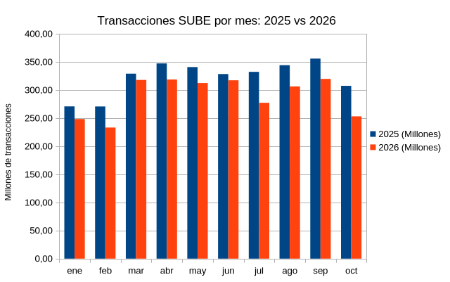
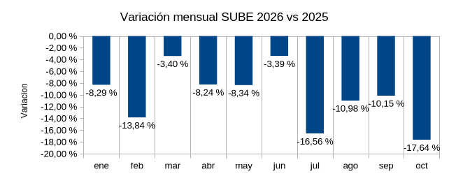
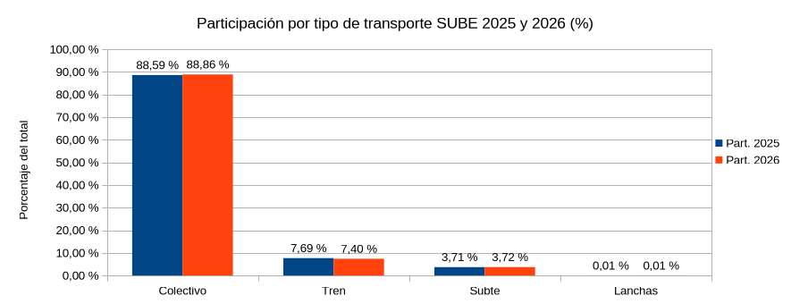

# Uso de la red SUBE: 2026 contra 2025

Comparación del uso de SUBE entre 2025 y 2026, con los mismos días de cada año (del 1 de enero al 27 de octubre). Proyecto de análisis de datos hecho desde la terminal de Linux, con SQLite y LibreOffice Calc.

## ¿Por qué este proyecto?
Quería practicar un flujo completo de análisis con datos reales y de gran tamaño (más de un millón de filas): revisar los archivos, importarlos, verificarlos, consultarlos con SQL y presentar los resultados con tablas y gráficos. Elegí SUBE porque es un tema cotidiano en Argentina y los datos son abiertos.

## Preguntas y respuestas
1. **¿Cuánto subieron o bajaron las transacciones en 2026 frente a 2025, usando los mismos días?**
   Bajaron un 9,99% (cerca de un 10%).
2. **¿Qué tipo de transporte se usa más y cómo cambió?**
   El colectivo concentra cerca del 89% en los dos años. El tren fue el que más bajó (-13,4%).
3. **¿Cómo se reparte por provincia?**
   Queda pendiente. La columna de provincia trae valores `JN` (posible jurisdicción nacional) y vacíos, que hay que tratar aparte.

## Resultados

Total de transacciones entre el 1/01 y el 27/10:

| Año | Transacciones |
|---|---|
| 2025 | 3.224.864.561 |
| 2026 | 2.902.662.060 |
| Variación | -9,99% |

Por tipo de transporte:

| Tipo | 2025 | 2026 | Variación | Participación 2025 | Participación 2026 |
|---|---|---|---|---|---|
| Colectivo | 2.856.933.016 | 2.579.383.775 | -9,7% | 88,6% | 88,9% |
| Tren | 248.009.230 | 214.871.169 | -13,4% | 7,7% | 7,4% |
| Subte | 119.508.712 | 107.989.281 | -9,6% | 3,7% | 3,7% |
| Lanchas | 413.603 | 417.835 | +1,0% | 0,013% | 0,014% |

Por mes (en millones de transacciones):

| Mes | 2025 | 2026 | Variación |
|---|---|---|---|
| Enero | 270,68 | 248,24 | -8,3% |
| Febrero | 270,55 | 233,11 | -13,8% |
| Marzo | 328,89 | 317,70 | -3,4% |
| Abril | 347,07 | 318,49 | -8,2% |
| Mayo | 340,61 | 312,20 | -8,3% |
| Junio | 328,22 | 317,11 | -3,4% |
| Julio | 332,08 | 277,08 | -16,6% |
| Agosto | 343,92 | 306,17 | -11,0% |
| Septiembre | 355,65 | 319,55 | -10,2% |
| Octubre (1 al 27) | 307,19 | 253,02 | -17,6% |

Todos los meses de 2026 quedaron por debajo de 2025. Enero, que no tiene datos preliminares, ya muestra -8,3%.







## Fuente de datos
Datos Argentina (datos.gob.ar), dataset "SUBE - Cantidad de transacciones (usos) por fecha". Se usaron los archivos CSV de 2025 y de 2026, descargados en octubre de 2026 y renombrados como `sube2025.csv` y `sube2026.csv`.

## Datos y verificación
- Columnas: `DIA_TRANSPORTE`, `NOMBRE_EMPRESA`, `LINEA`, `AMBA`, `TIPO_TRANSPORTE`, `JURISDICCION`, `PROVINCIA`, `MUNICIPIO`, `CANTIDAD`, `DATO_PRELIMINAR`.
- Los dos archivos tienen el mismo encabezado y están en UTF-8.
- 1.035.747 filas importadas: 541.557 de 2025 y 494.190 de 2026.
- 2025 tiene 365 días (01/01 al 31/12) y 2026 tiene 300 días (01/01 al 27/10), sin días faltantes.
- Los tipos de transporte son colectivo, tren, subte y lanchas. No hay una fila `TOTAL` que duplique las sumas.
- Datos preliminares: 46.731 filas, todas de 2026 (desde el 01/02), que equivalen a cerca del 8,75% de las transacciones de 2026.
- Los totales calculados con SQL coinciden con los de LibreOffice Calc.

## Método

**1. Revisión de los archivos en Linux (terminal)**
```
ls -lh                            # tamaño de los archivos
df -h                             # espacio libre en disco
wc -l sube2025.csv sube2026.csv   # cantidad de líneas
head -3 sube2025.csv              # encabezado y primeras filas
tail -2 sube2025.csv              # últimas filas (hasta qué fecha llega)
file sube2025.csv sube2026.csv    # codificación
```

**2. Importación a SQLite**
```
sqlite3 sube_usos.db
.mode csv
.import sube2025.csv sube
.import --skip 1 sube2026.csv sube
.mode column
.headers on
```
La segunda importación agrega el archivo de 2026 a la misma tabla y salta el encabezado.

**3. Comparación con los mismos días**
`CANTIDAD` se importa como texto, por eso se convierte a número con `CAST`. El filtro `SUBSTR(DIA_TRANSPORTE, 6) <= '10-27'` deja solo los días hasta el 27/10 en los dos años.
```sql
SELECT SUBSTR(DIA_TRANSPORTE, 1, 4) AS anio,
       SUM(CAST(CANTIDAD AS INTEGER)) AS total
FROM sube
WHERE SUBSTR(DIA_TRANSPORTE, 6) <= '10-27'
GROUP BY anio;
```
Las demás consultas (verificaciones, tipo de transporte, mes, datos preliminares) están en `consultas.sql`.

**4. Tablas y gráficos en LibreOffice Calc**
Los resultados se exportaron a CSV desde SQLite (`.output archivo.csv`), se abrieron en Calc y se guardaron como `.ods`. Con ellos se armaron una tabla dinámica por mes y año, las columnas en millones, la variación (`=C3/B3-1`) y los gráficos. Los totales se compararon con los de SQL.

## Limitaciones
- Los datos preliminares (cerca del 8,75% de 2026) pueden corregirse y cambiar el tamaño de la baja.
- Una transacción no es una persona ni un viaje completo.
- Solo se cuentan los pagos con SUBE: no incluye taxis, aplicaciones de transporte ni combis que no la usen.
- En `PROVINCIA` hay valores `JN` y vacíos, por lo que el análisis provincial requiere un tratamiento aparte.
- Entre 2025 y 2026 aumentó la cantidad de líneas informadas (de 1.693 a 2.154), lo que puede deberse a cambios de cobertura o de nombres.
- Las mismas fechas caen en distintos días de la semana y feriados en cada año.
- Los datos muestran cuánto cambió el uso, no por qué.

## Herramientas
Linux (Debian), terminal Konsole, SQLite 3.46 y LibreOffice Calc.

## Cómo reproducirlo
1. Descargar los CSV de 2025 y 2026 desde Datos Argentina y renombrarlos como `sube2025.csv` y `sube2026.csv`.
2. Crear la base con los comandos del paso 2 del método.
3. Ejecutar las consultas: `sqlite3 sube_usos.db < consultas.sql`.

## Archivos del repositorio
- `README.md`: este documento.
- `consultas.sql`: todas las consultas del análisis.
- `sube_analisis.ods`: tabla dinámica y gráficos mensuales.
- `sube_tipo.ods`: tabla y gráfico por tipo de transporte.
- `grafico_mensual.png`, `grafico_variacion.png` y `grafico_tipo.png`: los tres gráficos.

Los CSV originales y la base de datos no se incluyen por su tamaño.
## Autor
Rodrigo Alejandro Juarez. En transición hacia una carrera en Análisis de Datos y Soporte IT.
